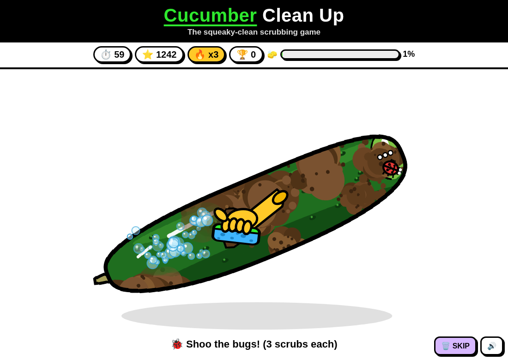

# 🥒 Cucumber Clean Up

A family-friendly, cartoon-style browser game: muddy cucumbers roll in from the garden, and you scrub them squeaky clean before the 60-second timer runs out.

**▶ Play it here: https://whatever4567.github.io/cucumber-clean-up/**

## How to play
- **Drag** with your mouse or finger to scrub the mud off. Each pass with the sponge removes more mud.
- Get a cucumber to **95% clean** and it sparkles and slides off. The next one bounces in.
- Clean them quickly, one after another (within about 6 seconds), to build a **combo**. Each combo level adds +50% points.
- **Soil clumps** need extra scrubbing before they crumble. **Bugs** walk around and need 3 scrubs each before they fly away.
- ✨ **Golden cucumbers** give x3 points and +3 seconds.
- 🤢 **Rotten cucumbers** can't be cleaned. **Swipe** them away fast, or press **🗑 SKIP** (or the `S` key), for bonus points. Skipping a good cucumber resets your combo.
- The game gets harder as you go: more mud, tougher clumps and more bugs.
- Your high score is saved on your device (localStorage).

Keys: `Enter`/`Space` start · `S` skip/toss · `M` mute.

## Features
- One `index.html` file. All the JS and CSS is inline, there are no external dependencies and no image files. Everything is drawn on `<canvas>`.
- Bold, thick-outlined cartoon look: a black header bar, a white background, a dark-green cucumber and a yellow cartoon glove holding a sponge.
- Canvas erase mask for the mud. The clean % is measured from the mask's pixels.
- **Cartoon jiggle physics** with classic squash-and-stretch. Damped spring-mass models (stiffness + damping, semi-implicit Euler, 3 substeps) drive the cucumber's **rotation**, **x/y squash-stretch** and a slight parabolic **bend**. Scrub velocity and direction feed in: off-centre strokes create torque, cross-strokes bend it, and along/across strokes stretch or squash it. Cucumbers get a bouncy spring entrance (with a landing squash) and a springy exit, and give a jelly wobble on combos, golden arrivals and clump pops. The body, mud mask and outline are composited into one sprite and drawn in vertical strips in the same transformed and bent space. Pointer input is mapped back through the inverse transform, so the mud you scrub always lines up with the wobbling cucumber.
- Juice: soap bubbles, sparkles, dirt crumbs, flying bugs, floating score popups and screen shake.
- Web Audio sounds generated in code: rubber-duck-style squeaks, a sponge rub, ding, pop, boing, whoosh, fanfare and countdown ticks.
- Works with mouse, touch and pen (Pointer Events). The layout adapts to portrait phones.

## Run locally
Just open `index.html` in any modern browser.
